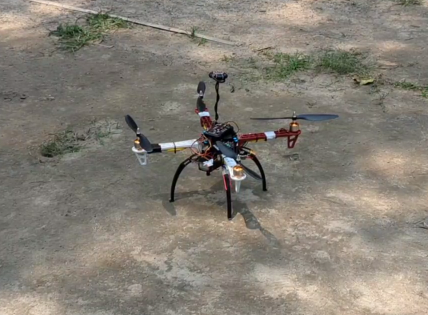
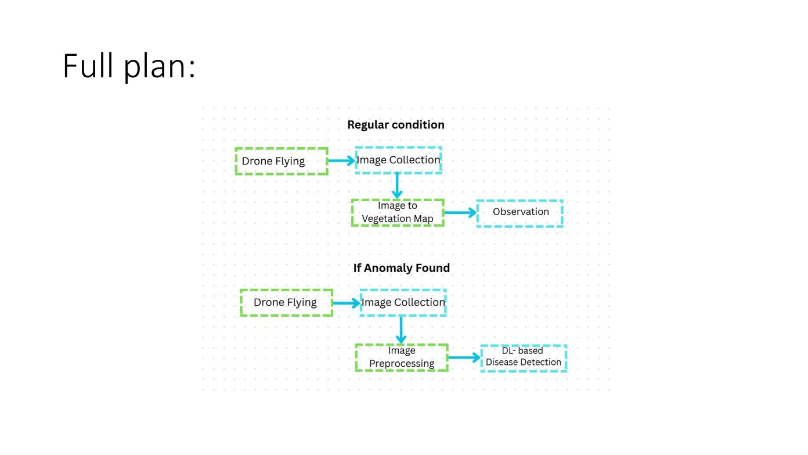
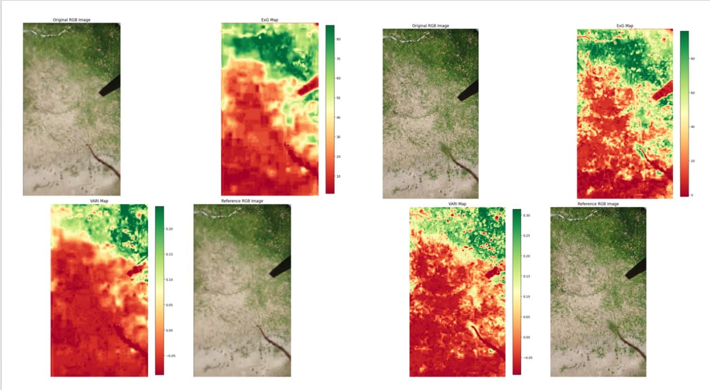
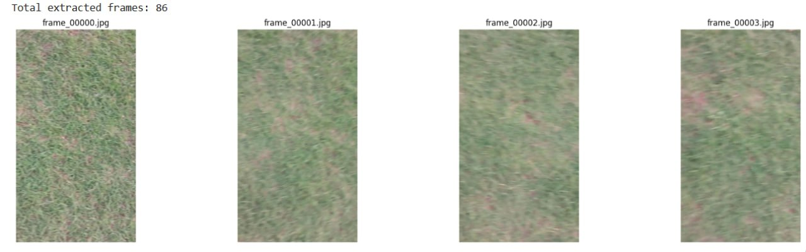
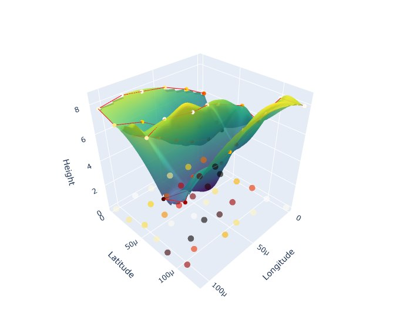
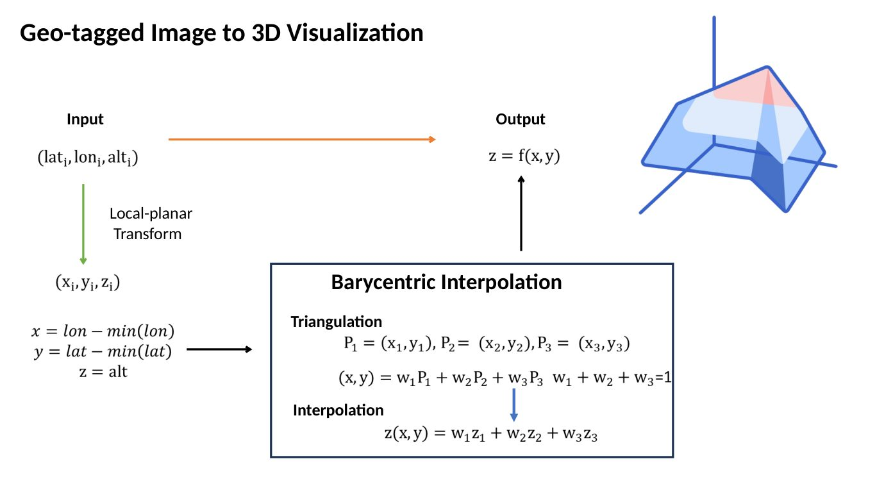
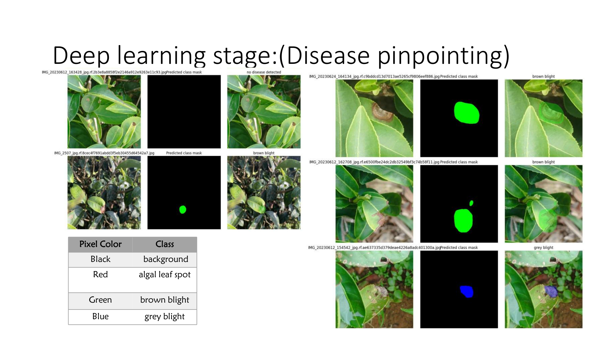
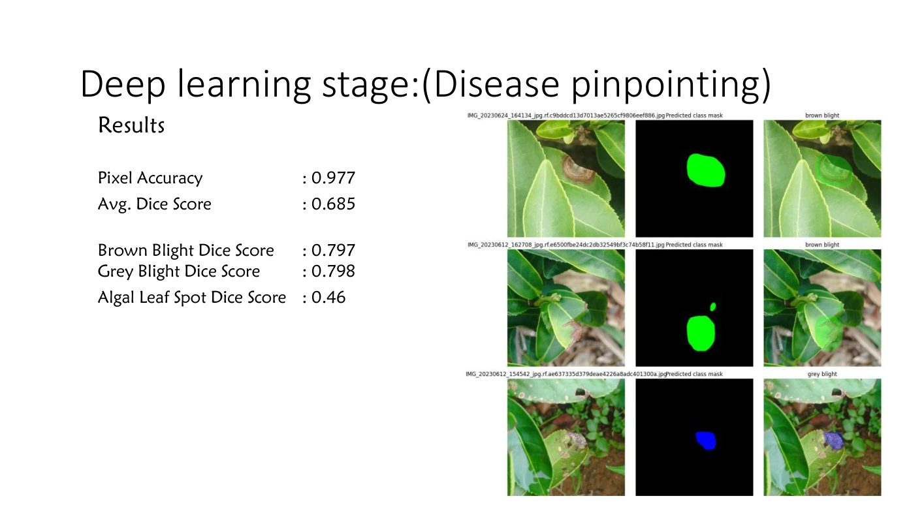
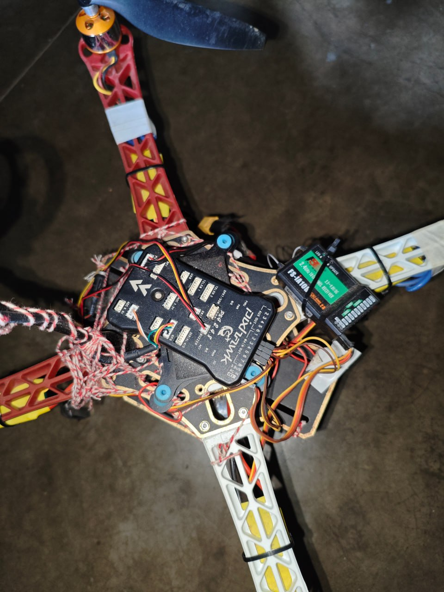
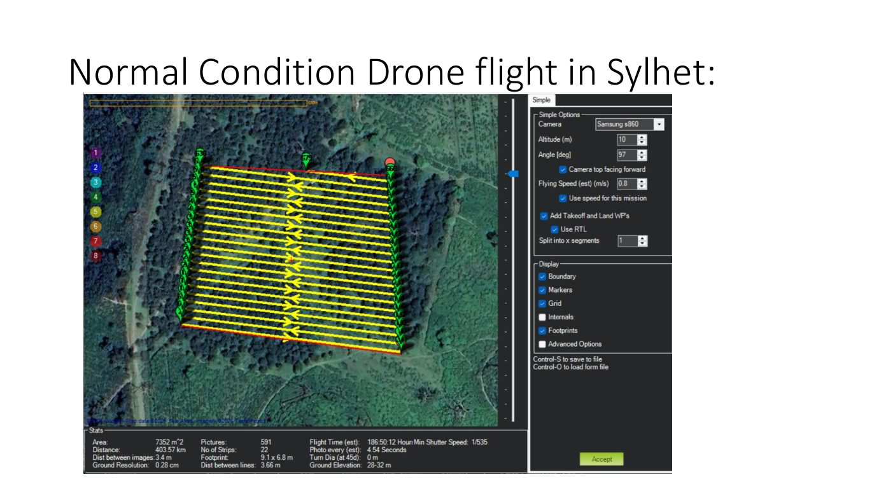

# UAV-Based Vegetation Stress Mapping and Tea Leaf Disease Analysis

**EEE 404 — Robotics and Automation Laboratory · BUET · Group 02**

A team project exploring a low-cost RGB-camera UAV workflow for vegetation monitoring in tea gardens. It combines **flight mission planning**, **video/frame processing**, **ExG and VARI vegetation mapping**, **synthetic-geotag 2D/3D visualization**, **SegFormer-B0 lesion segmentation**, and **ResNet50 disease classification**. This repository preserves the code, real project imagery, presentation figures, flight videos, original evaluation evidence, and detailed theory.



## Start here

| Read | What it covers |
|---|---|
| **[Mapping theory and mathematics](docs/mapping-theory.md)** | RGB indices, image sampling, pseudo-GPS, coordinate transforms, triangulation, barycentric interpolation, heatmaps, Folium and Plotly |
| **[Deep-learning theory and results](docs/deep-learning.md)** | SegFormer-B0, ResNet50, datasets, loss/metrics, model-specific training settings and evidence |
| **[Hardware and flight testing](docs/hardware-and-flight.md)** | F450 quadcopter, Pixhawk, Raspberry Pi, Mission Planner, flight trials, limitations |
| **[Complete visual gallery](docs/visual-gallery.md)** | from the team presentation |
| **[Technical report transcript](docs/report-technical-transcript.md)** | Original technical sections of the team report |

## Project overview



The proposed workflow begins with an RGB-camera UAV survey. Video frames are processed to visualize vegetation greenness; areas of low index value can be marked for closer inspection. The second stage uses close-up tea-leaf images for segmentation and classification. **The individual software and hardware components were developed and tested, but this repository does not demonstrate a fully autonomous end-to-end flight → anomaly detection → revisit → diagnosis deployment.**

## 1. RGB vegetation analysis and mapping

The vegetation pipeline extracts video frames and computes two indices from normalized RGB channels:

$$\mathrm{ExG}=2G-R-B$$

$$\mathrm{VARI}=\frac{G-R}{G+R-B+\varepsilon}$$

These describe **visible greenness**, not disease probability. Soil, shadows, lighting, and exposure can also lower index values. The demonstration uses **synthetic pseudo-GPS** along an assumed survey path; generated maps are **not GPS-validated field maps**. See the [complete theory](docs/mapping-theory.md).





The mapping presentation also documents the local-planar coordinate offset and triangulation/barycentric surface interpolation:



**Code:** [`vegetation_mapping.ipynb`](notebooks/vegetation_mapping.ipynb) · [`vegetation_mapping.py`](scripts/vegetation_mapping.py)

## 2. SegFormer-B0 — tea-leaf lesion segmentation

Four pixel classes: background, algal leaf spot, brown blight, and grey blight. The **SegFormer-B0** training notebook uses 512×512 inputs, batch size 4, AdamW, learning rate 2e-5, and up to 25 epochs. The saved execution output verifies results on **200 test images** from a **1,158-pair** dataset.

| Test metric | Saved B0 execution result |
|---|---:|
| Pixel accuracy | **97.7322%** |
| Foreground mean Dice | **0.684832** |
| Foreground mean IoU | **0.657452** |
| Algal leaf spot Dice | 0.459425 |
| Brown blight Dice | 0.796744 |
| Grey blight Dice | 0.798326 |



**Code:** [`segformer_tea_leaf_segmentation.ipynb`](notebooks/segformer_tea_leaf_segmentation.ipynb) · **Evidence:** [`results/`](results/) · **Theory:** [SegFormer architecture and Dice](docs/deep-learning.md)

## 3. ResNet50 — seven-class tea-leaf classification

A separate **ResNet50** experiment classifies teaLeafBD leaf images into seven categories. The original training code uses ImageNet-pretrained ResNet50, stratified splitting, class-weighted cross-entropy, AdamW, cosine scheduling, and early stopping. We record **93.18% test accuracy** and **0.9309 weighted F1**. These are classification metrics and must not be attributed to SegFormer segmentation.



**Code:** [`resnet50_tea_leaf_classification.ipynb`](notebooks/resnet50_tea_leaf_classification.ipynb) · **Theory:** [Classification vs segmentation](docs/deep-learning.md)

## 4. UAV hardware, flight planning and field work

The team's platform used an F450 quadcopter, Pixhawk/ArduPilot flight controller, Raspberry Pi 4, and RGB imaging. Mission Planner was used to develop survey and targeted-waypoint flight plans. We document **61 bench calibration attempts and 23 outdoor attempts**, with **14 successful outdoor flights and 9 failures**.




**[Hardware and flight details](docs/hardware-and-flight.md)** · [Project video](videos/uav-project-video.mp4) · [Landing video](videos/drone-landing.mp4) · [Flight video](videos/drone-flight.mp4)

## Code and repository layout

```text
notebooks/        vegetation mapping, SegFormer-B0, ResNet50
scripts/          reusable RGB vegetation processing
results/          original SegFormer-B0 execution excerpt and CSV
images/           real project photos and outputs
  presentation/   28 team presentation slides
  mapping-slides/ 4 mapping/visualization slides
  report-figures/ 16 illustrated report pages
docs/             theory, hardware, gallery, source transcript
videos/           3 flight/project videos
data/             placeholder (datasets not distributed)
README.md
requirements.txt
.gitignore
```

## Reproducing the code

```bash
pip install -r requirements.txt
python scripts/vegetation_mapping.py --help
```

Open the notebooks and update dataset paths. The SegFormer notebook expects training/validation/test image–mask directories; the ResNet50 notebook expects the teaLeafBD classification dataset. 

## Provenance, scope, and corrections

- This was a **six-person group project**. 
- The 2D/3D pseudo-GPS maps are **demonstrations**, not calibrated orthomosaics, measured topography, or validated geographic disease locations.
- The [report transcript](docs/report-technical-transcript.md) preserves historical source wording, including claims that should be read in light of the above clarifications. 

## Project media and further reading

Explore the **[full illustrated gallery](docs/visual-gallery.md)** and the **[technical report sections](docs/report-technical-transcript.md)**. The gallery contains the actual presentation imagery and figures rather than generic stock illustrations.
