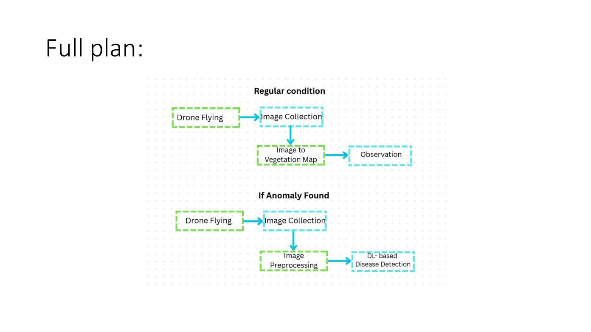
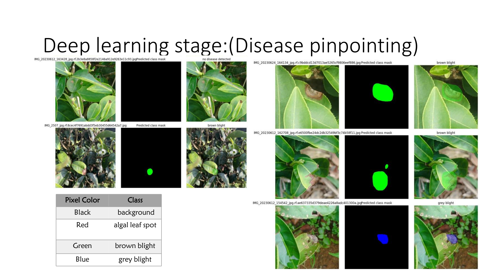
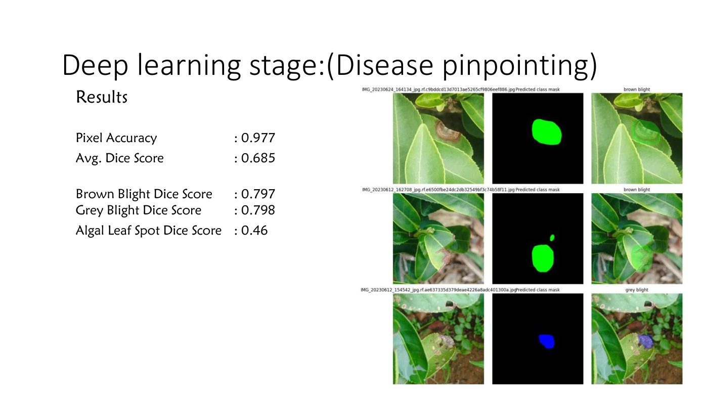

# Tea-leaf disease analysis — SegFormer and ResNet50

The project contains **two distinct deep-learning experiments**. The original report sometimes combines their descriptions. This document separates them using the actual notebooks and available execution logs.

## Why tea-leaf models?

The UAV vegetation maps identify areas of relatively low visible greenness. Those maps cannot identify disease type. The team's proposed second stage uses close-up images of tea leaves to investigate suspected disease. The close-up leaf datasets are separate from the aerial RGB video and should not be treated as automatically linked or geolocated observations.

## A. SegFormer-B0 — pixel-level lesion segmentation

**Task:** four-class semantic segmentation: background (0, black), algal leaf spot (1, red), brown blight (2, green), grey blight (3, blue). The data comprise 1,158 image–mask pairs, split into 759 train, 199 validation, and 200 test images in the uploaded execution record.

**Architecture:** SegFormer uses a hierarchical Mix Transformer (MiT) encoder to produce features at multiple scales and a lightweight MLP decoder to combine them into pixel-level predictions. The uploaded notebook initializes `nvidia/segformer-b0-finetuned-ade-512-512` and changes the segmentation head to four labels. The model therefore is **SegFormer-B0**, not B2.

**Training:** 512×512 inputs, batch size 4, maximum 25 epochs, learning rate 2e-5, AdamW, and best-checkpoint selection by validation mean Dice. The source report's table lists **B2 / 100 epochs / batch 8 / 6e-5**, but that table does not describe the B0 run whose log supports the results below.

**Test results from the saved B0 execution log (200 images):**

| Metric | Value |
|---|---:|
| Pixel accuracy | 97.7322% |
| Foreground mean Dice | 0.684832 |
| Foreground mean IoU | 0.657452 |
| Algal leaf spot Dice | 0.459425 |
| Brown blight Dice | 0.796744 |
| Grey blight Dice | 0.798326 |

For a class with prediction mask `P` and ground truth `G`, the Dice coefficient is `2|P∩G|/(|P|+|G|)` and IoU is `|P∩G|/|P∪G|`. Pixel accuracy can be high even when lesion Dice is modest because background pixels often dominate the image. The comparatively lower algal-leaf-spot Dice indicates a segmentation weakness for that class; do not claim uniform performance.

**Code:** [`segformer_tea_leaf_segmentation.ipynb`](../notebooks/segformer_tea_leaf_segmentation.ipynb). **Evidence:** [`segformer_b0_execution_excerpt.txt`](../results/segformer_b0_execution_excerpt.txt).

## B. ResNet50 — image-level disease classification

**Task:** seven-way classification on the separate **teaLeafBD** dataset: tea algal leaf spot, brown blight, gray blight, helopeltis, red spider mite, green mirid bug, and healthy leaf. The uploaded notebook uses a TorchVision ImageNet-pretrained ResNet50 with a replaced final classification layer.

**Training pipeline:** stratified 70/15/15 train/validation/test split, 224×224 input, batch size 32, class-weighted cross-entropy, AdamW with learning rate 3e-4, cosine scheduling, mixed precision, early stopping, and a confusion-matrix-based evaluation. The group report records approximately **93.18% test accuracy** and **0.9309 weighted F1** for this experiment. Those report figures have not been recomputed in this repository.

For multiclass classification, precision `TP/(TP+FP)`, recall `TP/(TP+FN)`, and F1 `2PR/(P+R)` are computed per class. Weighted F1 averages class F1 scores using class support as weights. It is **not** a pixel-level segmentation metric.

**Code:** [`resnet50_tea_leaf_classification.ipynb`](../notebooks/resnet50_tea_leaf_classification.ipynb).

## How the two models relate

SegFormer predicts **where** a lesion appears in a leaf image. ResNet50 predicts **which disease category** an entire leaf image belongs to. They are complementary experiments, not a single cascaded network proven in flight. The report's statement that a single SegFormer model achieved both the segmentation accuracy and seven-class weighted F1 conflates the tasks; the actual uploaded code shows two models.

## Reproducibility

The original training data and checkpoints are not included. Update dataset paths in each notebook. The notebooks were reorganized and syntax checked, but were not rerun here. The SegFormer test metrics are supported by an original saved execution excerpt; the ResNet50 test figures are from the team report.
