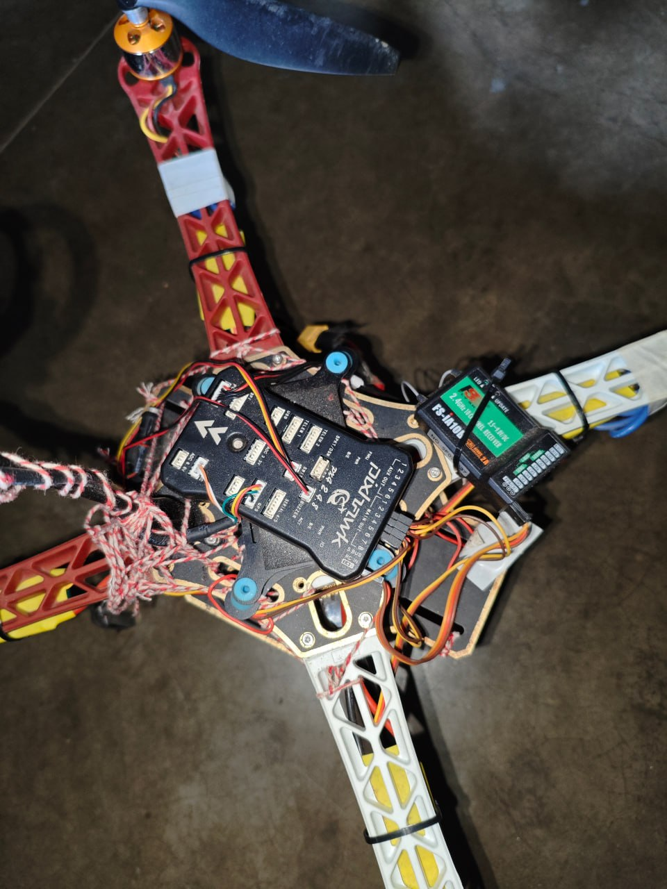
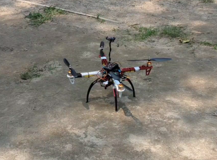
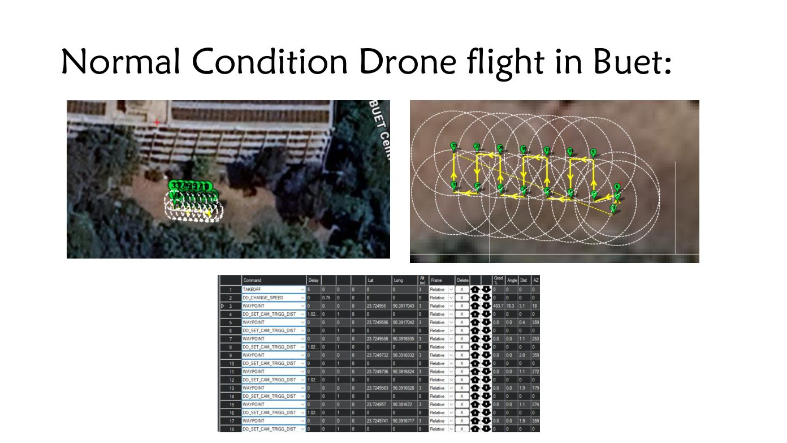
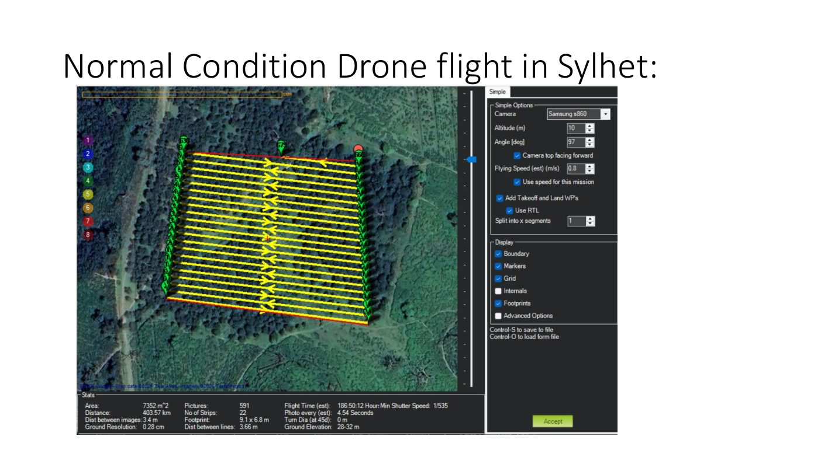

# UAV hardware, mission planning, and flight testing

The EEE 404 project combined a custom quadcopter with an RGB-camera-based mapping workflow. This page documents the **team's hardware and flight work**; it does not imply that every team member individually built or piloted the aircraft.

## Quadcopter hardware

The report specifies an F450 450 mm frame, four A2212 1000 KV brushless motors, four 30 A SimonK ESCs, a Pixhawk flight controller running ArduPilot, Raspberry Pi 4 (2 GB) companion computer, RGB camera, u-blox M8N GPS module, 3S LiPo battery packs, and 10×4.5 propellers. The flight controller manages stabilization and navigation; the Raspberry Pi is intended for camera/image-related processing. The report describes serial MAVLink communication. The photograph below shows the team's assembled UAV.

## Mission planning

The normal-condition plan uses back-and-forth survey strips and periodic camera triggering; the anomaly-condition plan is a targeted waypoint revisit. The report documents BUET campus trials and a planned Sylhet tea-garden survey. Mission Planner screenshots and elevation profiles are reproduced in the gallery.

## Testing

The report records **84 attempts**: 61 bench calibration trials and 23 outdoor flight attempts. Of the outdoor attempts, **14 were successful** and **9 ended in crashes/failures** (8 successful/6 failures at BUET, 6 successful/3 failures at Sylhet). Bench trials were for motor/ESC response, PID tuning, and safety checks, not 61 additional successful flights. Flight endurance and wind/GPS reliability remained limitations.

## Media

- [UAV project demonstration](../videos/uav-project-video.mp4)
- [Drone landing](../videos/drone-landing.mp4)
- [Drone flight recording](../videos/drone-flight.mp4)

## Costs and future work

The report estimates a prototype budget around **BDT 50,000**. This is a historical student-project cost estimate, not a current purchasing quote. Future work includes real geotag synchronization, better environmental robustness, verified field labels, and faster on-device inference.
