# UAV mapping, image processing, and 3D visualization — theory

This technical guide follows the project report (sections 3.4–3.5), the five-slide **Drone Mapping and Visualization** presentation, and the accompanying Python notebooks. It explains the principles behind the implementations, including their limitations.

## 1. Why an RGB UAV?

Tea gardens cover large areas, so repeated manual inspection is costly. A low-cost quadcopter with a conventional RGB camera can collect spatially distributed imagery. The proposed system has two phases: (1) regular survey, vegetation mapping, and anomaly flagging; (2) close-up revisit and leaf-disease analysis. These were developed as project components; a fully automated end-to-end closed-loop field system was **not** demonstrated by the published notebooks.

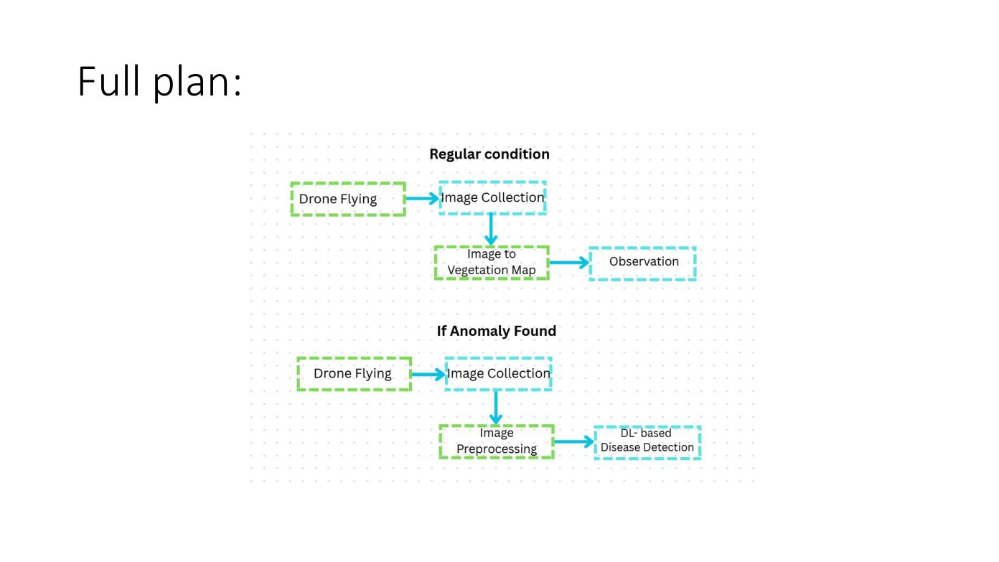

## 2. Flight planning and image acquisition

A **boustrophedon** (lawnmower) flight pattern traverses the region in alternating strips to cover the target surface while reducing transit time. Mission Planner was used to define routes and camera triggers. The report gives an illustrative Sylhet survey plan with area 7,352 m², altitude 10 m AGL, 22 strips, 0.8 m/s speed, 3.4 m capture spacing, and 591 estimated images. These are **planning parameters**, not a claim that all 591 images were acquired. The report's displayed distance of 403.57 km is implausible for the indicated area; it is retained in the original source, but is not presented here as verified flight distance.

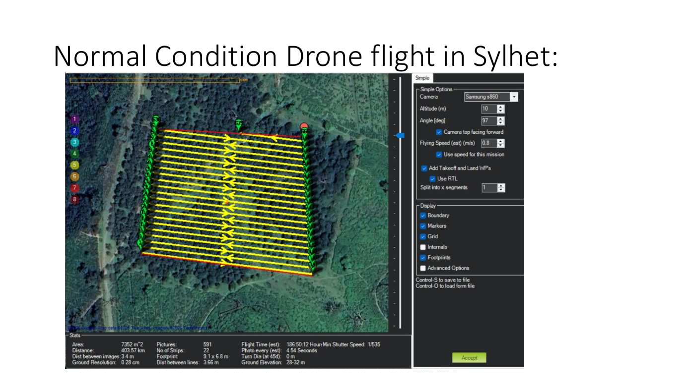
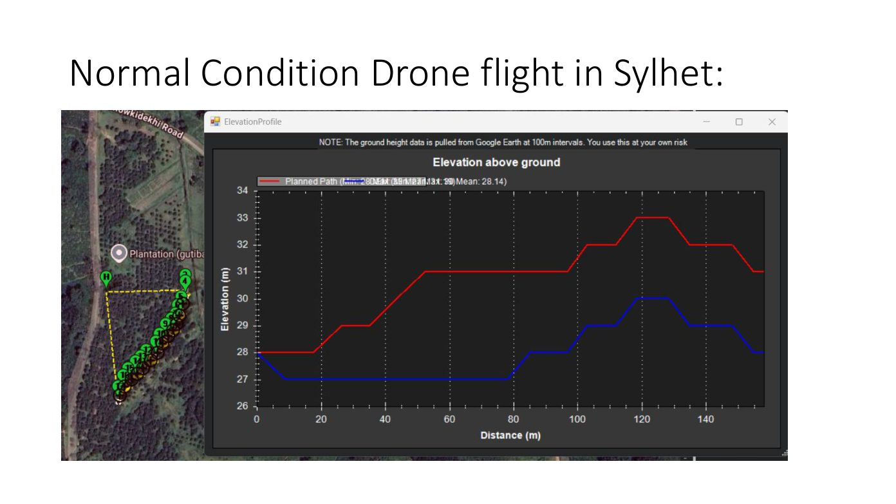

The mapping pipeline samples frames from video using OpenCV. If the input frame rate is `fps` and one frame is retained every `k` frames, the effective sample rate is `fps/k` frames per second. Temporal subsampling reduces compute cost but also reduces spatial sampling density and can leave gaps when flight speed is high.

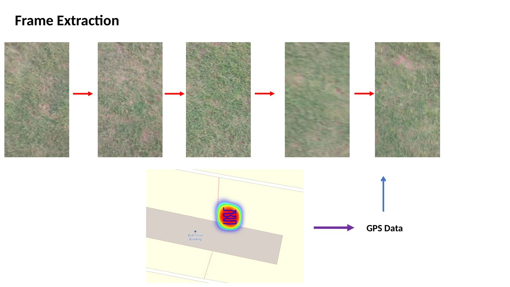

## 3. Synthetic GPS and EXIF metadata

The mapping demonstration assigns each extracted frame a **synthetic/pseudo-GPS** coordinate along a modelled serpentine path, with optional perturbations for drift, wobble, and jitter. These are not camera-measured GPS coordinates and cannot establish true ground position or map accuracy. The mapping slides illustrate video → frame extraction → GPS/EXIF → visualization. In a production pipeline, image timestamps would instead need synchronization with measured flight-controller GPS/IMU logs, camera calibration, and coordinate transformations.

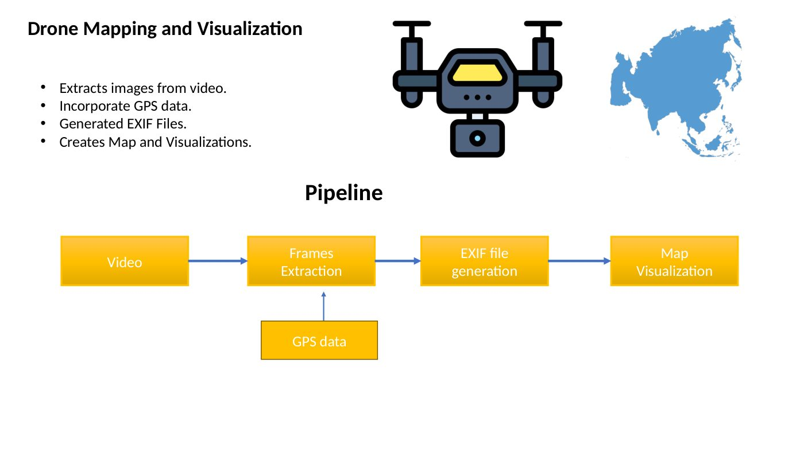

## 4. RGB vegetation indices

For each RGB pixel, normalize channels to `[0,1]`. The **Excess Green index** emphasizes green relative to red and blue:

$$\mathrm{ExG}=2G-R-B.$$

The **Visible Atmospherically Resistant Index** is:

$$\mathrm{VARI}=\frac{G-R}{G+R-B+\varepsilon}.$$

Here `ε` prevents numerical division by zero. In code, guarding the *magnitude* of the denominator is preferable to simply adding epsilon because `G+R-B` can be negative or close to zero. ExG and VARI measure visible color characteristics, **not disease diagnoses**. Low values may arise from bare soil, shadows, dry vegetation, occlusions, camera exposure, or disease. A disease-specific interpretation requires ground truth.

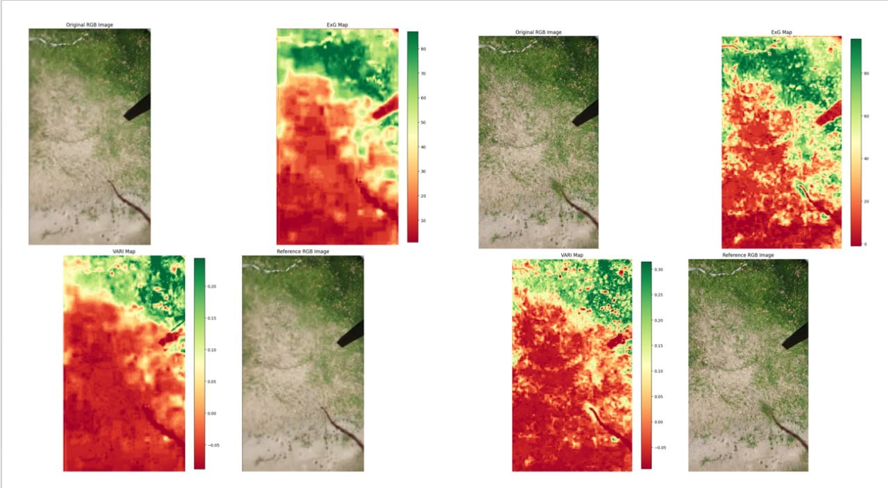
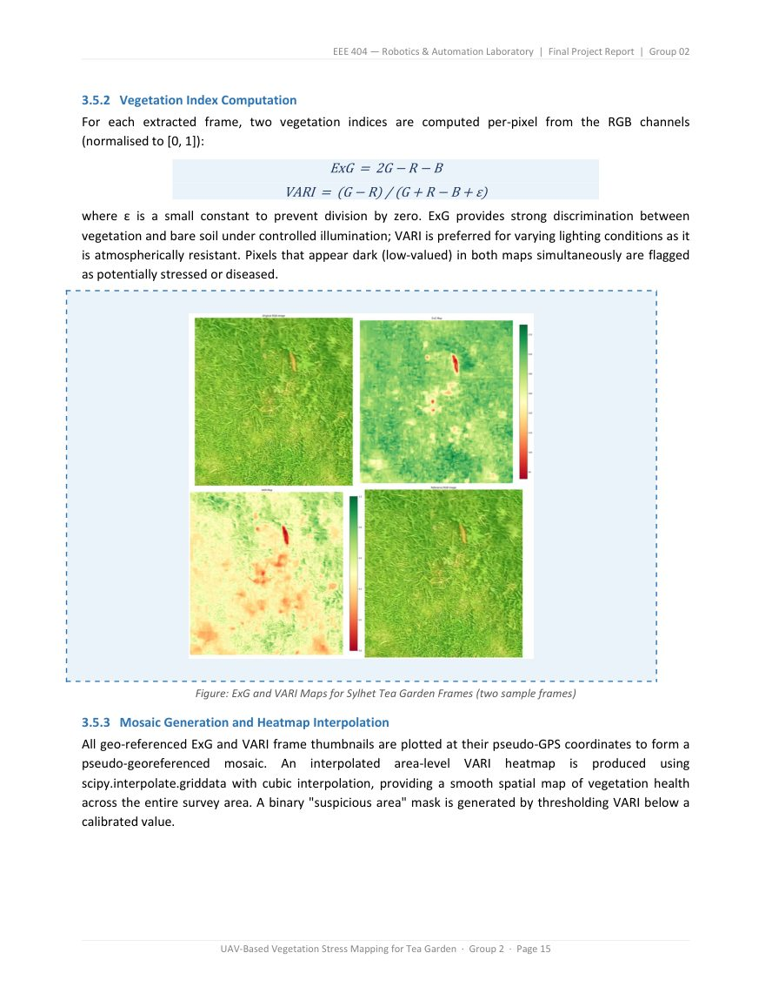

## 5. Pseudo-georeferenced mosaics and heatmaps

Frames can be placed at their associated position samples to make a **visual mosaic**. Because this project's positions were synthetic, the mosaic is a **pseudo-georeferenced demonstration** and is not a photogrammetric orthomosaic. For an area-level index, the pipeline can aggregate pixel values per frame and interpolate across sparse frame centers using `scipy.interpolate.griddata` with cubic interpolation. Interpolation produces a smooth visualization; it does **not** add new measurements or establish the accuracy of a stress boundary. Regions outside the convex hull of observed points may be undefined.

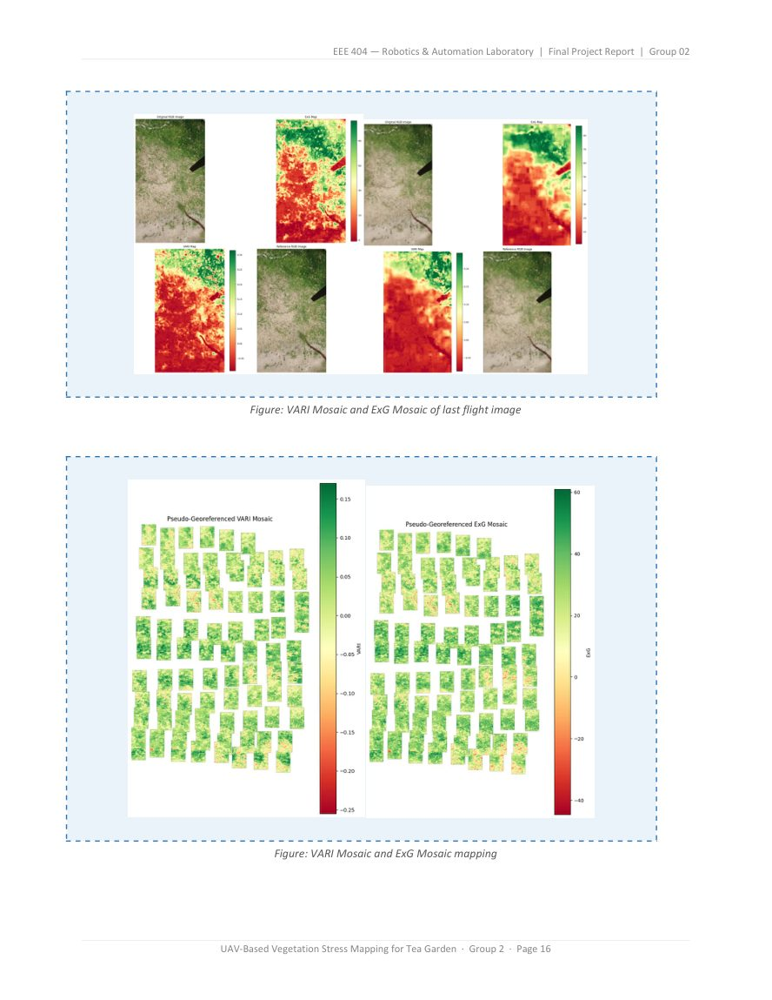
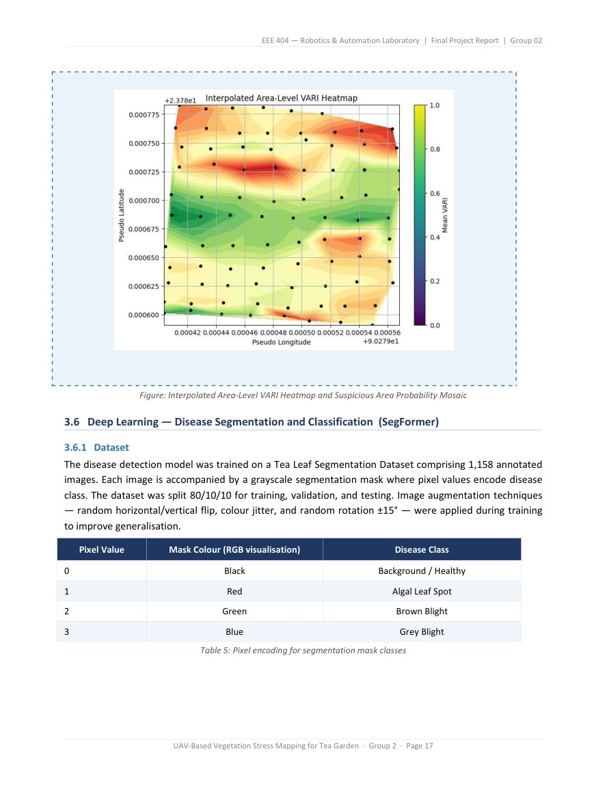

## 6. Coordinate conversion

The mapping slides show a simple local planar transform:

$$x=\lambda-\min(\lambda),\qquad y=\phi-\min(\phi),\qquad z=h,$$

where longitude `λ`, latitude `φ`, and altitude `h` form the inputs. **This is a coordinate offset, not a conversion into meters.** A metric local tangent-plane approximation near latitude `φ₀` is instead

$$x\approx R\cos(\phi_0)(\lambda-\lambda_0),\qquad y\approx R(\phi-\phi_0),$$

with latitude and longitude in **radians**, Earth radius `R`, and a consistent vertical datum. The metric formula is additional engineering context; the simple offset is what the slides depict.

## 7. Triangulation and barycentric interpolation

Discrete sample points `(xᵢ,yᵢ,zᵢ)` can be triangulated into a piecewise-linear surface. For a point inside triangle with vertices `P₁,P₂,P₃`, find weights `w₁,w₂,w₃` satisfying

$$\begin{bmatrix}x\\y\\1\end{bmatrix}=w_1\begin{bmatrix}x_1\\y_1\\1\end{bmatrix}+w_2\begin{bmatrix}x_2\\y_2\\1\end{bmatrix}+w_3\begin{bmatrix}x_3\\y_3\\1\end{bmatrix},\quad w_1+w_2+w_3=1.$$

Then interpolate the height:

$$z(x,y)=w_1z_1+w_2z_2+w_3z_3.$$

For a point inside a nondegenerate triangle, the weights are nonnegative. The result is **piecewise planar**, not automatically smooth in surface slope. If positions and heights are simulated, the resulting 3D surface is an illustrative rendering, **not measured terrain reconstruction**.

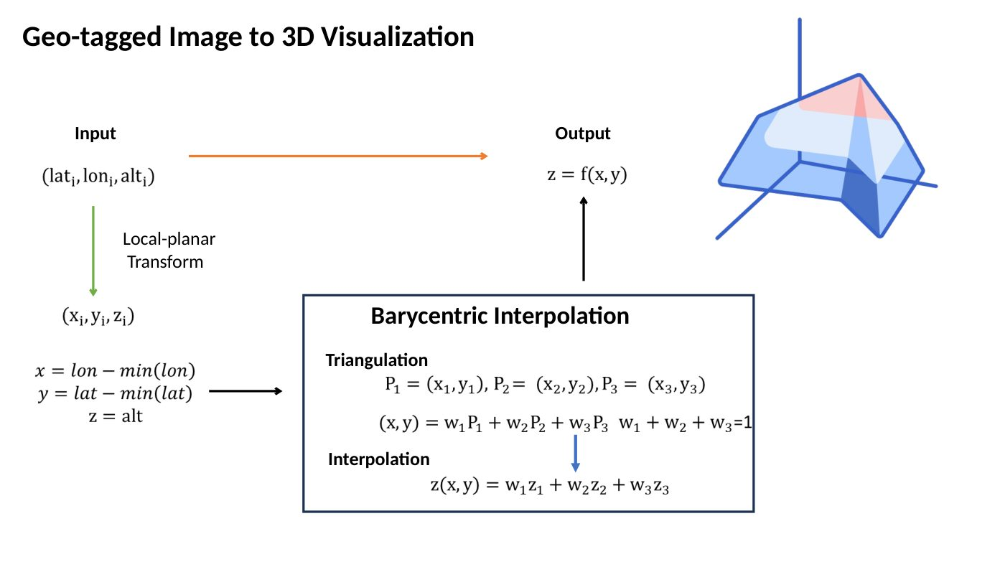
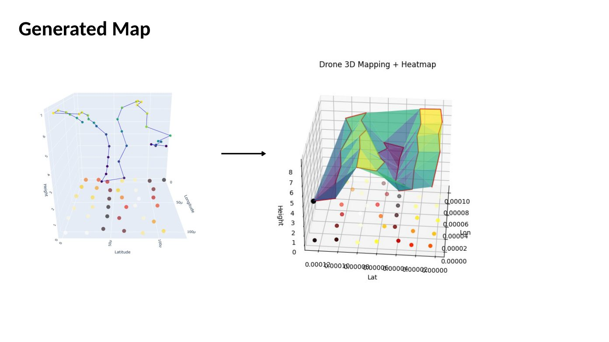

## 8. Visualization tools

**Folium** supports interactive 2D maps and overlays. **Plotly** supports interactive 3D surfaces and trajectories. In the project, these were used to visualize the mapped samples, indices, and synthetic spatial surfaces. The visualization is useful for debugging and demonstrating the pipeline, but real map coordinates require synchronized measured GPS data.

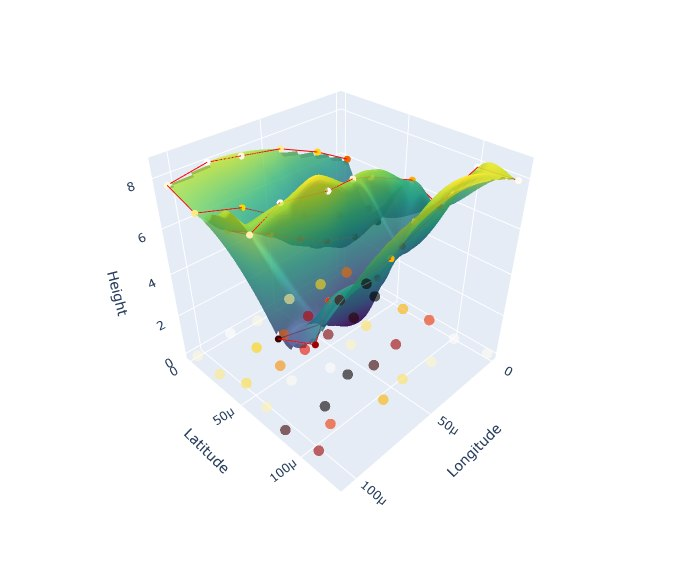

## 9. Potential anomaly detection and targeted revisit

A heuristic can flag low-index regions in ExG and VARI. This is a **screening signal**, not proof of infection. The proposed follow-up flight would revisit flagged coordinates and acquire close-up leaf images. The project report sketches a Mission Planner sequence `TAKEOFF → WAYPOINT → LOITER/DELAY → RETURN_TO_LAUNCH`. This was a design concept and mission-planning component, not a demonstrated automatic linkage between the heatmap notebook and flight controller.

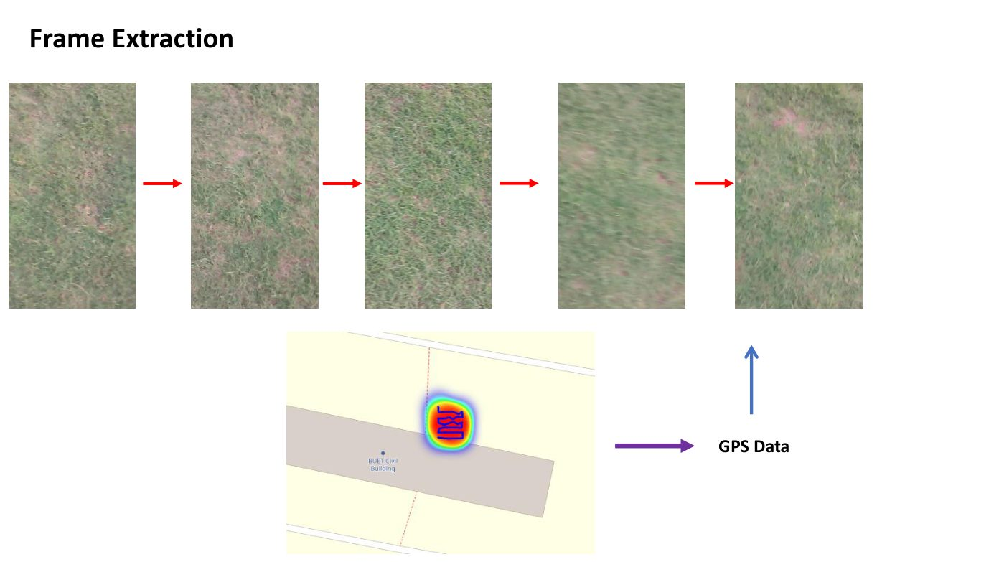

## 10. Failure modes and future improvements

Important limitations include: synthetic geotags; camera exposure and illumination variability; no calibrated vegetation-stress labels; interpolation artifacts; wind and flight-controller instability; limited battery endurance; and the absence of verified automated UAV-to-deep-learning integration. Useful next steps include GPS/IMU timestamp synchronization, calibrated camera intrinsics, real georeferenced ground truth, stress-map validation, and on-device inference optimization.
